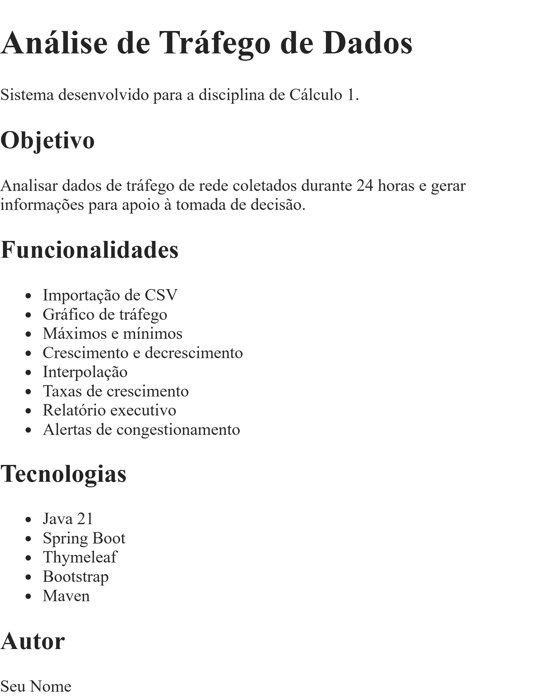

Análise de Tráfego de Dados
Sistema desenvolvido para a disciplina de Cálculo 1.

Objetivo
Analisar dados de tráfego de rede coletados durante 24 horas e gerar informações para apoio à tomada de decisão.

Funcionalidades
Importação de CSV
Gráfico de tráfego
Máximos e mínimos
Crescimento e decrescimento
Interpolação
Taxas de crescimento
Relatório executivo
Alertas de congestionamento
Tecnologias:
Java 21
Spring Boot
Thymeleaf
Bootstrap
Maven
Autor:
Plínio Tiago da Silva